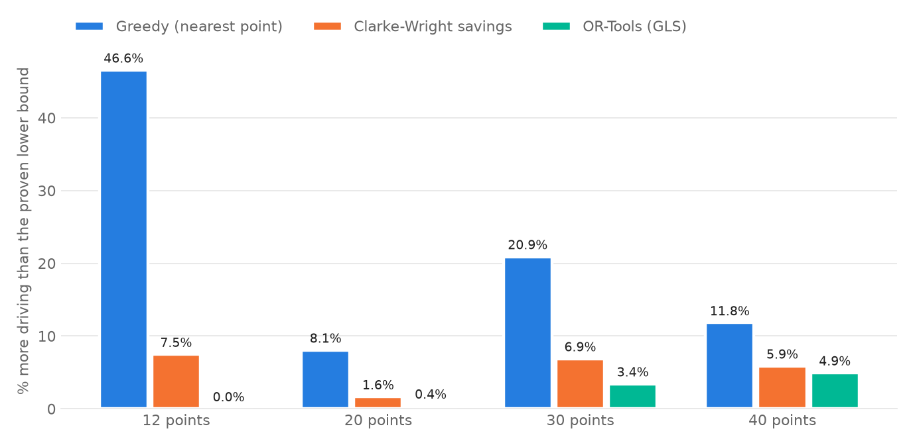
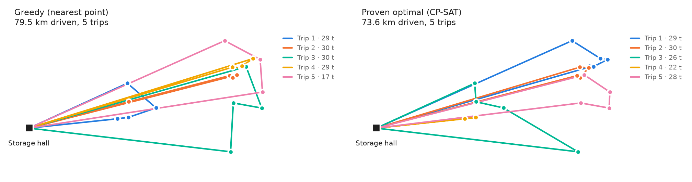

# How far from optimal is a simple truck-routing rule?

*Truck collection routes on an industrial site, solved with heuristics, a metaheuristic
and exact optimisation, with proven lower bounds.*

For my Master's final project (Logistics Engineering, 2025), I worked on the internal
transport of a large phosphate processing site. Trucks from a fleet of 8 to 12 collected
product around the site. I built a shortest-path routing heuristic and a web
decision-support tool, with an estimated 15% reduction in cycle time.

The project left one question open: **how far from the best possible plan were those
routes?** A heuristic gives a plan, not a proof. This repository answers that question on
instances with the same structure, by comparing:

- simple and classic heuristics,
- a modern metaheuristic,
- exact methods that compute a **lower bound** no plan can beat.

> **Data note.** The instances are synthetic, generated from fixed seeds in
> `src/site_routing/instance.py`. They reproduce the shape of the real problem (a site of
> about 8 × 5 km, clustered production areas, 3–12 t per point, 30 t per truck trip). They
> contain no company data.

## The problem

A storage hall sends trucks to collect product from *n* points. Each point holds *q* tonnes.
A trip can carry at most *Q* = 30 t, and every point is visited exactly once. The objective
is to minimise the total distance driven. This is the **Capacitated Vehicle Routing Problem
(CVRP)**. Road distances are straight-line distances × 1.3 (a standard detour factor). In
the original project, travel times came from Google Maps.

## Methods

| Method | Type | Proof of quality? |
|---|---|---|
| Greedy "nearest point that fits" | Constructive heuristic (the rule a planner uses by hand) | No |
| Clarke & Wright savings (1964) | Classic constructive heuristic | No |
| Google OR-Tools, Guided Local Search (10 s) | Metaheuristic | No |
| Textbook MIP: two-index model with MTZ load constraints (SCIP, 60 s) | Exact | Lower bound |
| LP relaxation + rounded capacity cuts (cutting planes) | Bounding | Lower bound |
| CP-SAT: circuit constraint + exact load constraints (120 s) | Exact | Optimum, or lower bound |

Each method is explained in plain words in [docs/how-it-works.md](docs/how-it-works.md).

## Results

The percentages show how much more each plan drives than the **best proven lower bound**.
0% means the plan is proven optimal.

| Site | Greedy | Clarke-Wright | OR-Tools | Exact (CP-SAT) | Status |
|---|---|---|---|---|---|
| 12 points | 64.4 km (+46.6%) | 47.2 km (+7.5%) | 43.9 km (0.0%) | **43.9 km** | proven optimal in 1 s |
| 20 points | 79.5 km (+8.1%) | 74.8 km (+1.6%) | 73.9 km (+0.4%) | **73.6 km** | proven optimal in 12 s |
| 30 points | 84.7 km (+20.9%) | 74.8 km (+6.9%) | 72.4 km (+3.4%) | 72.4 km (+3.4%) | time limit, gap 3.4% |
| 40 points | 117.6 km (+11.8%) | 111.4 km (+5.9%) | 110.4 km (+4.9%) | 110.4 km (+4.9%) | time limit, gap 4.9% |



How strong each lower bound is (km):

| Site | Textbook MIP (60 s) | LP + capacity cuts (< 1 s) | CP-SAT (120 s) | Best plan found |
|---|---|---|---|---|
| 12 points | 43.9 | 41.5 | 43.9 | 43.9 |
| 20 points | 49.6 | 72.8 | 73.6 | 73.6 |
| 30 points | 56.2 | 68.4 | 70.0 | 72.4 |
| 40 points | – (not run) | 97.5 | 105.2 | 110.4 |

The 20-point site, greedy routes against the proven optimal routes:



## What the results show

1. **The natural rule is expensive.** "Go to the nearest point that fits" drove 8% to 47% more
   than the lower bound on these sites. On the 12-point site it also needed a fourth trip,
   so it used 32% more truck time (293 vs 222 minutes, including loading and unloading).
2. **Classic algorithms recover most of the loss, metaheuristics nearly all of it.** OR-Tools
   was within 0.4% of optimal wherever optimality could be proven, but it cannot show that by
   itself.
3. **The textbook exact model fails early.** At 20 points its bound (49.6 km) is 33% below the
   optimum (73.6 km), so it cannot prove anything. Adding rounded capacity cuts to the linear
   relaxation lifts the bound to 72.8 km in under a second. This is the idea behind
   branch-and-cut.
4. **Proof stops scaling quickly.** CP-SAT proves the optimum up to 20 points. At 30–40
   points it is left with a 3–5% gap after two minutes, and real sites are larger and harder.
5. **An honest negative result:** feeding the capacity cuts into CP-SAT did not speed it up.
   CP-SAT already generates similar cuts internally.

## What I want to study next

Real site transport adds constraints this model ignores: shift lengths, trucks making several
trips per shift, loading-bay capacity, several products, and uncertain travel and loading
times. These make the exact problem much larger. I want to research methods that keep a
quality guarantee at that scale:

- **Column generation / branch-and-cut-and-price.** Choose among whole trips instead of single
  arcs, with stronger cuts.
- **Matheuristics and decomposition.** Exact optimisation inside heuristics for problems
  too big to prove.
- **Practical decision-support tools.** Planners on real industrial sites should be able to
  use the results.

## Run it

```bash
python -m venv .venv
.venv\Scripts\activate        # Windows  (Linux/macOS: source .venv/bin/activate)
pip install -r requirements.txt
python run.py                 # full run, about 10 minutes (writes results/ and figures/)
python run.py --quick         # short time limits, about 1 minute
```

The exact results above come from an 8-thread CPU (AMD Ryzen 7 5700X). Time-limited runs
can differ slightly between machines.

## Repository layout

```
src/site_routing/
  instance.py        site instances (generation, distances, save/load)
  heuristics.py      greedy nearest point, Clarke-Wright savings
  ortools_solver.py  OR-Tools routing with Guided Local Search
  mip.py             textbook MIP, LP cutting planes, CP-SAT exact model
  solution.py        feasibility check, distance, trip time
  plot.py            figures
run.py               runs everything, writes results/*.csv and figures/*.png
instances/           the generated instances (JSON)
docs/how-it-works.md plain-language explanation of every method
```

## Author

Amine Ouahbi, Master's in Logistics Engineering (Université Hassan II, Casablanca, 2025).
I am looking for a PhD in optimisation for transport and supply chain logistics.

MIT licence.
